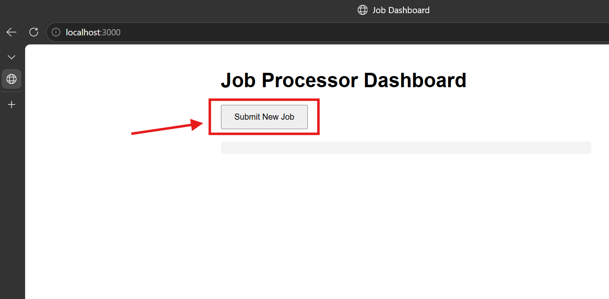
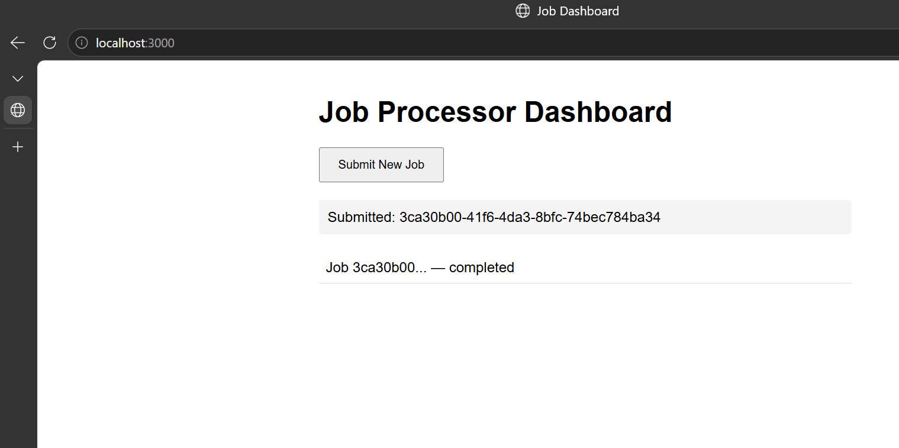

# Shipping Distributed Application

A multi-container job-processing application built for the HNG Stage 2 DevOps track. The original project requirements are available [here](docs/REQUIREMENTS.md).

This project tests the ability to take a provided multi-service application and make it production-ready through containerization and a full CI/CD pipeline.


## Architecture


The application consists of four containers:

| Component | Responsibility |
| --- | --- |
| Frontend | Node.js and Express web interface for submitting jobs and checking their status. |
| API | FastAPI service that creates job IDs, queues jobs in Redis, and returns job status. |
| Worker | Python background process that consumes queued jobs and updates their status. |
| Redis | Stores the job queue and job-status data. Accessible to the other containers over the Compose network. |

The frontend is exposed on port `3000`; the other services communicate over the Docker Compose network.

## Getting Started

### Prerequisites 
- Git  
- Docker  
- Docker Compose v2.

### Steps to run locally

Verify all required programms are installed. 

```bash
git --version
docker --version
docker compose version
```

### 1. Clone the repository

```bash
git clone https://github.com/onakorame-dimon/shipping-microservice-application.git
cd shipping-microservice-application
```

### 2. Build the application images

The Compose file uses image names supplied through environment variables, so build the three application images first:

**IMPORTANT:** Remember to romve the names in curly braces and tag the image with whatever name you choose. 

```bash
docker build -t {FRONTEND_IMAGE} ./services/frontend
docker build -t {BACKEND_IMAGE} ./services/api
docker build -t {WORKER_IMAGE} ./services/worker
```

### 3. Configure the environment

Replace example environment variable with the requirend configuration variables:

```bash
cp .env.example .env
```
**IMPORTANT:** The `.env` file should **NOT** be commited to git!

#### Required configuration variables


| Variable | Purpose | Local example |
| --- | --- | --- |
| `FRONTEND_IMAGE` | Frontend image reference | `local/frontend:dev` |
| `BACKEND_IMAGE` | API image reference | `local/api:dev` |
| `WORKER_IMAGE` | Worker image reference | `local/worker:dev` |
| `REDIS_IMAGE` | Redis image reference | `redis:8.0-alpine` |
| `API_URL` | API address used by the frontend container | `http://api:8000` |
| `REDIS_HOST` | Redis service name on the Compose network | `redis` |
| `REDIS_PORT` | Redis port | `6379` |
| `REDIS_PASSWORD` | Password required for redis connection | Set a local development value |

### 4. Start the application

```bash
docker compose up -d
```

### 5. Submit and check a job

You can use the web interface to submit a job.

Open [http://localhost:3000](http://localhost:3000).



click on the `Submit New Job` button to receive the job response



### 6. Stop the application

```bash
docker compose down
```
## Repository documentation

| File | Purpose |
| --- | --- |
| [Project requirements](docs/REQUIREMENTS.md) |Contains the project tasks  |
| [Reflections ](docs/REFLECTIONS.md)  | Key decisions, challenges, and lessons learned during implementation
| [Fixes](docs/FIXES.md)  |  document containing every bug found in original application code. 